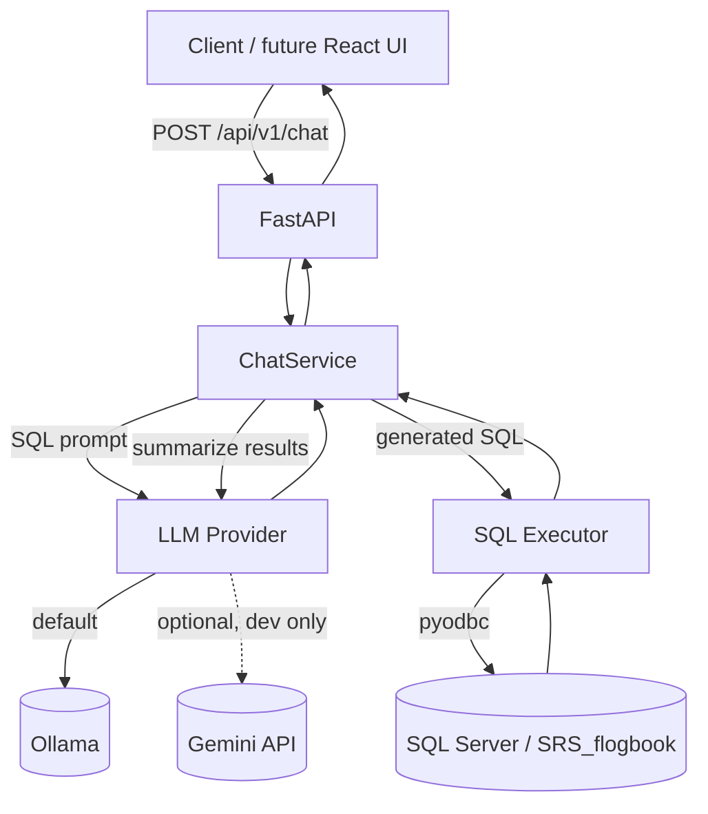

# Indus Faultbook Assistant

Natural-language assistant for the Indus fault book. It converts an operator's question into a SQL Server `SELECT`, runs it against the fault database, and summarizes the results with a local LLM.

> **Status: Phase 1 (not production-ready).**
> Generated SQL is parsed with SQLglot and restricted to a single read-only statement, but a full SQL guard (table allowlist, enforced row limits), a read-only database account, authentication/RBAC, and audit logging are **not implemented yet** and are required before production use.

## Overview

The assistant is designed for air-gapped, internal deployments:

- **Ollama is the default LLM provider** and the only air-gap path.
- **Gemini is optional** and intended for local development only.
- The database is an existing SQL Server instance; the app is read-only by convention, not yet enforced.
- The API is versioned under `/api/v1` and exposes a health endpoint for operators.

## Architecture



| Component | Responsibility |
| --- | --- |
| `app/api` | Versioned HTTP routes and dependency wiring |
| `app/core` | Configuration, logging, lifespan, settings |
| `app/schemas` | Pydantic request/response models |
| `app/services/nl2sql` | Prompt building, SQL execution, orchestration |
| `app/services/providers` | LLM provider interface, Ollama, Gemini, factory |
| `app/prompts` | Versioned prompt templates |
| `app/resources` | Database schema used to ground SQL generation |

## Current features and limitations

Implemented:

- Natural-language question to SQL to summary pipeline
- Provider abstraction with Ollama (default) and Gemini (optional)
- `GET /api/v1/health` and `POST /api/v1/chat`
- Versioned API, typed request/response schemas
- Unit, integration, and real-dependency E2E tests
- Rotating logs, typed settings, linting and type-checking

Not implemented yet:

- SQL guard allowlist and enforced row limits (single-statement parse is in place)
- Read-only database login and connection pooling
- Authentication, RBAC, rate limiting, audit trail
- Conversation history and feedback capture
- Frontend

## Tech stack

- Python 3.12+
- FastAPI + Uvicorn
- Pydantic v2 / pydantic-settings
- pyodbc (SQL Server), SQLglot (planned SQL validation)
- httpx (Ollama HTTP client)
- uv (dependency management)
- Ollama (local LLM), optional Google Gemini
- pytest, ruff, mypy

## Repository structure

```
indus-faultbook-assistant/
├── README.md
├── .gitignore
├── docs/                      # reserved for architecture/ADRs/runbooks
└── backend/
    ├── pyproject.toml
    ├── uv.lock
    ├── .env.example
    ├── app/
    │   ├── main.py            # create_app() and Uvicorn entrypoint
    │   ├── api/               # /api/v1 routes and dependencies
    │   ├── core/              # config, logging, lifespan
    │   ├── schemas/           # request/response models
    │   ├── services/
    │   │   ├── nl2sql/        # prompts, executor, orchestrator
    │   │   └── providers/     # LLM provider abstraction
    │   ├── prompts/           # SQL generation and summarization templates
    │   └── resources/         # database schema snapshot
    └── tests/
        ├── unit/
        ├── integration/
        └── e2e/               # real SQL Server + Ollama
```

## Prerequisites

- Python 3.12 or newer
- [uv](https://docs.astral.sh/uv/)
- Microsoft ODBC Driver 18 for SQL Server
- Access to the SQL Server instance hosting `SRS_flogbook`
- Ollama running locally with the configured model pulled

## Quick start

```powershell
cd backend

# Install app + dev + optional Gemini dependencies
uv sync --all-extras

# Create local configuration
Copy-Item .env.example .env
# Edit .env and set DB_PASSWORD (and GEMINI_API_KEY only if using Gemini)

# Pull the default local model
ollama pull lfm3:latest

# Start the API
uv run uvicorn app.main:app --reload --port 8080
```

For an Ollama-only (air-gapped) installation, run `uv sync` without extras:

```powershell
uv sync
```

POSIX shells can use `cp .env.example .env`.

Open `http://localhost:8080/docs` for the interactive API documentation.

## Configuration

All settings are read from `backend/.env` or environment variables.

| Variable | Default | Description |
| --- | --- | --- |
| `APP_ENV` | `dev` | Environment name (`dev`, `staging`, `prod`) |
| `CORS_ORIGINS` | `http://localhost:5173` | Comma-separated allowed origins |
| `DB_HOST` | `localhost` | SQL Server host |
| `DB_PORT` | unset | Optional TCP port. Unset uses local Shared Memory for a default instance; set `1433` to force TCP |
| `DB_NAME` | `SRS_flogbook` | Database name |
| `DB_USERNAME` | `sa` | Database login (use a read-only account in production) |
| `DB_PASSWORD` | required | Database password |
| `DB_TRUST_SERVER_CERT` | `true` | Trust a self-signed server certificate |
| `DB_TIMEOUT_SECONDS` | `15` | Connection/query timeout |
| `LLM_PROVIDER` | `ollama` | `ollama` (air-gap) or `gemini` (dev only) |
| `OLLAMA_BASE_URL` | `http://localhost:11434` | Ollama endpoint |
| `OLLAMA_TIMEOUT` | `120000` | Ollama request timeout in milliseconds |
| `OLLAMA_MODEL` | `lfm3:latest` | Local model name |
| `OLLAMA_THINK` | `false` | Enable model reasoning output. Keep `false` for SQL generation so the model returns only the query |
| `GEMINI_API_KEY` | empty | Required only when `LLM_PROVIDER=gemini` |
| `GEMINI_MODEL` | `gemini-2.5-flash-lite` | Gemini model name |

Secrets belong in `backend/.env`, which is gitignored. Never commit real credentials; `.env.example` contains placeholders only.

## Database

The assistant is grounded on the `dbo.fault_bookv3` table in `SRS_flogbook`. The schema snapshot used for prompting lives at `backend/app/resources/schema.sql`.

| Column | Type | Nullable |
| --- | --- | --- |
| `fault_id` | `bigint` | no |
| `fault_time` | `datetime` | no |
| `fault_duration` | `varchar(25)` | no |
| `system_name` | `varchar(50)` | yes |
| `device_name` | `varchar(50)` | yes |
| `fault_description` | `varchar(2000)` | yes |
| `persons_involved` | `varchar(200)` | yes |
| `action_taken` | `varchar(500)` | yes |
| `faulty_system` | `varchar(200)` | yes |
| `human_error` | `varchar(200)` | yes |
| `document` | `image` | yes |
| `document_name` | `varchar(50)` | yes |
| `fda_entry` | `varchar(3)` | no |
| `logged_by` | `varchar(25)` | yes |
| `log_time` | `datetime` | yes |
| `first_observation` | `varchar(4000)` | no |
| `beam_affected` | `varchar(3)` | no |

Binary `image` values are replaced with `"<binary>"` before results reach the LLM.

## API reference

### `GET /api/v1/health`

```json
{
  "status": "ok",
  "db": "up",
  "llm_provider": "ollama",
  "model": "lfm3:latest"
}
```

`status` is `degraded` when the database is unreachable. The endpoint stays available so load balancers can distinguish an unhealthy dependency from a dead process.

### `POST /api/v1/chat`

Request:

```json
{
  "question": "How many fault records are in the fault_bookv3 table?"
}
```

Response:

```json
{
  "answer": "The fault_bookv3 table contains 7,247 fault records.",
  "sql": "SELECT COUNT(*) AS row_count FROM [dbo].[fault_bookv3];",
  "row_count": 1
}
```

PowerShell:

```powershell
Invoke-RestMethod http://localhost:8080/api/v1/health | ConvertTo-Json

Invoke-RestMethod -Method Post http://localhost:8080/api/v1/chat `
  -ContentType 'application/json' `
  -Body '{"question":"List 3 recent faults related to control systems"}' | ConvertTo-Json
```

`curl.exe`:

```powershell
curl.exe -s http://localhost:8080/api/v1/health

curl.exe -s -X POST http://localhost:8080/api/v1/chat `
  -H "Content-Type: application/json" `
  -d "{\"question\":\"List 3 recent faults related to control systems\"}"
```

## Testing

Run from `backend/`.

```powershell
# Unit and integration tests (E2E skipped)
uv run pytest -q

# End-to-end tests against real SQL Server and Ollama
$env:RUN_E2E='1'; uv run pytest tests/e2e -q -s
Remove-Item Env:RUN_E2E

# Lint and type-check
uv run ruff check app tests
uv run mypy app
```

E2E tests are gated by `RUN_E2E=1` and automatically skip when SQL Server or the configured Ollama model is unavailable. They validate the full path: HTTP request, SQL generation, database execution, and summarization.

## License

Proprietary. Internal enterprise use only. All rights reserved.
